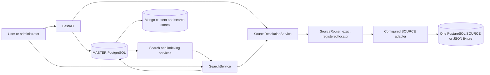
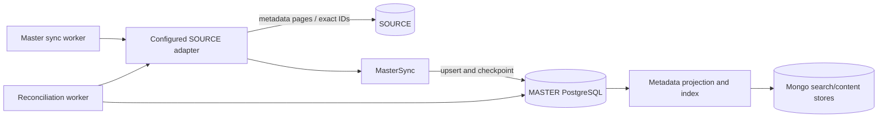
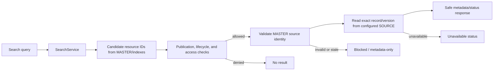
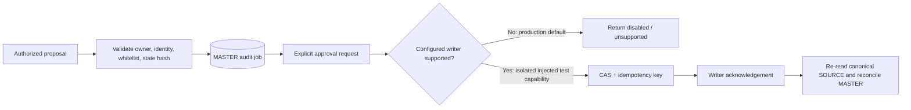
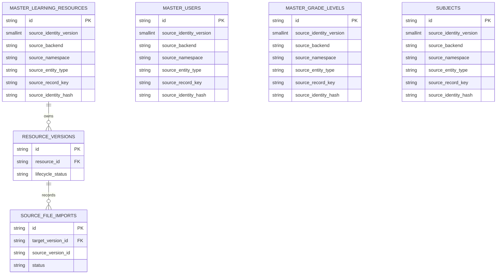

# ETL source federation: current state and readiness

## Scope and verdict

This document records the current working tree on `fix/source-federation-regression` at
HEAD `0f09832`; no real SOURCE database was contacted. It separates implemented
behavior from the multi-source design requested by Prompt 02. SOURCE schemas in this
repository are assumptions; no external SOURCE database was contacted.

| Capability | Current evidence | Status |
|---|---|---|
| Single SOURCE configuration | `composition.create_source()` constructs one JSON fixture or PostgreSQL adapter from settings | Implemented |
| Stable source identity | `SourceLocator` and SHA-256 identity; Alembic `0020` adds identity columns/indexes to `master_users`, `master_learning_resources`, `master_grade_levels`, `subjects` | Implemented for one locator per MASTER row |
| Server-side SOURCE registry | Validated `SOURCE_REGISTRY_CONFIG` and `ConfiguredSourceRegistry`; connection URLs are resolved only from server environment references, never from client input | Implemented in process memory; supported runtime adapter currently PostgreSQL |
| SOURCE identity mapping and routing | Identity tuple/hash stored on existing MASTER entity rows and resolved by backend plus namespace; no mapping table | Implemented and tested using existing MASTER models |
| Multiple-source metadata synchronization | Feature-gated `MasterSync` selects an exact registered adapter, creates opaque internal MASTER IDs, maps parent/child relations, and isolates stream checkpoints per source | Implemented and tested with two fixture sources in isolated SQLite; physical PostgreSQL contract remains untested |
| Per-source missing-record reconciliation | Preview/apply is source-scoped, bounded, fingerprinted, audited, soft-deletes only that source mapping, and marks it stale | Implemented and tested with two fixture sources in isolated SQLite; physical PostgreSQL concurrency behavior remains untested |
| Capability-gated SOURCE content processing | `read_content`, `process_content`, and `index_derived_content` are independent server-side capabilities, false by default. Remote bytes use bounded RAM for OCR/index only; ETL file-download and preview endpoints remain disabled | Implemented in working tree; focused tests pass. Only registrations granting all three capabilities can schedule OCR/index work |
| In-memory formats | PDF text/scanned pages, DOCX, XLSX, PPTX, TXT, CSV and raster images use byte/stream processors; Tesseract SOURCE path uses stdin | Implemented in code; OCR engine runtime and end-to-end acceptance must be verified. MP3/MP4 remain unsupported for SOURCE because current processors require files |
| Exact SOURCE lookup | Resolver validates stored identity, requests only metadata from the exact adapter, checks the bounded SOURCE-to-MASTER parent chain, and revalidates the mapping; legacy byte retrieval is disabled | Implemented and regression-tested for single SOURCE; mapped multi-SOURCE lookup has contract tests only |
| Source version identity | Internal MASTER version IDs link to `source_file_imports.source_system + source_version_id`; source namespace and identity hash are stored in existing `resource_versions.processing_options` | Implemented for exact-version adapters; bounded to existing 30-character import/version ID fields and fail-closed on overflow or mutation |
| Source file reference and open API | Authenticated `GET /api/v1/resources/{id}/open` resolves the exact version and a source-provided or validated Google Drive link at request time; viewer hosts must be registered HTTPS and secret URL parameters are rejected | Drive links are checked against configured bucket root, file metadata, revision stability, and host allowlist; browser can embed Drive preview or open Drive directly. Physical Drive access remains untested |
| Frontend source open | Resource version panel requests the open API and displays only backend-verified HTTPS viewer links | Implemented; local-owned preview/download flow is unchanged |
| Per-source health | Authenticated `GET /api/v1/source-federation/health` returns sanitized status per registered source | Implemented; physical external health checks were not run |
| SOURCE writeback | Durable proposal state uses MASTER audit jobs, but production composition injects `DisabledSourceMetadataWriter`; test writer is in-memory | Safe default implemented; production writer blocked |
| Physical SOURCE/Mongo tests | No explicitly approved isolated SOURCE test endpoints were configured for this work | Not run |
| Browser E2E | Existing tests are Node contract/component tests; no browser run evidence in this turn | Not run |

**Readiness:** `NOT_READY_FOR_PRODUCTION`. No production SOURCE grants are enabled by default; do not interpret unit tests with fake adapters as physical integration evidence. `SOURCE_FEDERATION_ENABLED` defaults to false. Metadata, version identity, checkpoints, reconciliation and viewer resolution reuse existing MASTER tables. Real PostgreSQL/Mongo/API viewer integration, source-owner authorization contract, physical SOURCE acceptance, browser E2E and migration-governance approval remain incomplete or blocked.

## Current regression pass (2026-11-01)

This pass follows the supplied regression prompt on the existing branch. It did not
switch branches, reset/discard files, change schema, run migrations against a real
database, connect to production SOURCE/Mongo/cloud services, commit, or push.

| Check | Result | Evidence / classification |
|---|---:|---|
| Focused five-commit regression | **PASS** | 33 passed |
| SOURCE reference + file preview contract | **PASS** | 50 passed, 2 skipped |
| SOURCE/Drive metadata-only, sync API, federation mapping and local-drive regression | **PASS** | 68 Drive + 20 metadata/sync/federation + 22 local-drive tests passed |
| All `tests/unit/test_source*.py` SOURCE/federation/OCR/reference/readiness tests | **PASS** | 292 passed in 154.64s; includes bounded-memory/no-persistence and capability checks |
| LOCAL upload/preview/OCR/chunk/index/media/deletion regression selection | **PASS** | 277 passed, 5 skipped in 215.63s; LOCAL original-file persistence and processing remain intact |
| File reconciliation, audit budget, scheduler migration and source catalogs | **PASS** | 39 passed |
| API/auth/worker stability and architecture boundaries | **PASS** | 80 passed + `test_master_auth.py` 34 passed; architecture dependency check 1 passed |
| Search/content/metadata/BoW/vector/index selection | **PASS** | 486 passed, 3 skipped (slowest test 68.78s) |
| Frontend contract tests (`node --test tests/frontend/*.mjs`) | **PASS** | 11 passed |
| Frontend auxiliary tests (`frontend/tests/*.test.mjs`) | **BLOCKED** | Combined run: 25 passed, 35 failed, 1 skipped; failures are direct `.ts` loading and browser/CDP startup constraints, not silently skipped |
| Frontend TypeScript + isolated Vite build | **PASS** | `tsc -b`; 2,016 modules transformed |
| Frontend lint | **PASS WITH WARNINGS** | Oxlint completed; existing React hook/Fast Refresh warnings remain |
| Full `tests/unit` | **BLOCKED/TIMEOUT** | Started with 2,458 collected tests, reached about 40% before interruption; the long-running embedding/OCR fixture requires shard isolation. Failures observed in that partial run were rerun in the focused groups above |
| Frontend `.mjs` suite importing `.ts` directly | **BLOCKED** | Node 22 reports `ERR_UNKNOWN_FILE_EXTENSION`; repository has no TS test runner script |
| Browser/CDP UI tests | **BLOCKED** | `CDP timeout` / `Page.enable` in the local environment |
| Physical PostgreSQL SOURCE, Mongo, Drive/cloud and production acceptance | **NOT_RUN** | Explicitly prohibited/unavailable in this pass |

The current test contract intentionally preserves SOURCE originals at the provider:
discovery stores only metadata and opaque MASTER version identity; the legacy SOURCE
file worker does not claim or copy bytes. A missing authorized viewer/derived text is
reported as `SOURCE_OPEN_UNSUPPORTED` or `FILE_NOT_READY`, and reconciliation records
`EXTERNAL_SOURCE_CONTENT_DISABLED` as `NOT_VERIFIED` rather than pretending that the
file matched. LOCAL ingestion and preview paths remain separate.

### Historical 26-failure disposition

The historical `303 PASS / 26 FAIL` command was not stored in the repository, so the
exact original test ordering cannot be reconstructed without inventing evidence. The
affected test families were rerun by file and are mapped below; the final result is
the focused-suite evidence in this report, not the historical aggregate.

| Failure family / affected tests | Root cause | Classification | Resolution and final evidence |
|---|---|---|---|
| SOURCE original-file assertions in `test_database_auth.py`, `test_file_preview.py`, `test_master_auth.py`, `test_media_file_response.py`, `test_media_out_of_scope.py`, `test_source_google_drive.py`, `test_source_sync_files.py`, `test_sync_local_drive_regression.py`, `test_file_reconciliation_jobs.py` | Tests still expected SOURCE bytes, local copies, retries, or OCR jobs from the retired legacy worker | A — legacy assertion | Updated tests to metadata/reference-only behavior; worker remains disabled for original import. Source and LOCAL selections PASS |
| `test_source_reference.py`, `test_source_federation_mapping.py`, `test_file_preview.py` | Revoked lifecycle or allowed-status fixture did not update the persisted import row; text view could dereference absent derived text | D/B — fixture and implementation | Fail-closed status checks and `FILE_NOT_READY` mapping added; focused SOURCE/reference suites PASS |
| `test_source_catalogs.py`, `test_reconciliation_scheduler_migration.py`, `test_media_migration.py` | Assertions targeted stale timeout/schema-revision expectations | C/D — contract drift | Assertions now reflect the checked-out contracts; reconciliation/catalog and migration tests PASS |
| `test_api_migrations.py`, `test_reconcile_master.py`, source registry/router imports | Architecture test found BOMs and an application-layer ORM import | B — implementation/architecture | Removed BOMs and persisted reconciliation audit rows through repository ports; architecture check PASS |
| `test_database_auth.py` forwarded-error path and `test_audit_io.py` budget path | Typed `SearchError` was collapsed to generic 400; in-memory streams lacked a file-descriptor EOF path | B/C — API and stream handling | Preserved typed status/code and added bounded in-memory EOF handling; auth/worker and audit groups PASS |

No remaining implementation failure from these families was observed in the rerun
groups. The full-suite timeout and browser/TypeScript runner failures below are
environment/test-harness blockers, not silently reclassified as PASS.

## Current architecture

The diagrams below describe the existing single-source path and the feature-gated federation path. No federation table schema is defined or installed.

### Overall data flow

The existing `source_identity_*` values live on selected MASTER entity rows. They do not form a separate mapping registry. Mongo content/search storage is a MASTER-side component; it is not a second SOURCE adapter.

### Metadata synchronization

The worker runs against the one configured source. Checkpoints and reconciliation do not currently carry an independently routed source registry key for N sources.

### Search and exact-source resolution

Resolution does not try another source when the selected source fails. With a valid persisted mapping, the master resource ID is independent of the source record key. Without a mapping, the legacy route is allowed only for one registered SOURCE with matching IDs. Feature-gated metadata sync also assigns opaque MASTER IDs; imports and versions are still outside that mapping lifecycle.

### Writeback state

The production composition always supplies `DisabledSourceMetadataWriter`. `InMemorySourceMetadataWriter` is process-local test support and does not prove durability across restart or multiple workers. Do not describe the current flow as exactly-once SOURCE writeback.

### Current identity model (not a proposed ERD)

This is the current column-based identity model. There is no `source_registry` or generic `source_identity_mapping` table in migrations through `0020`.

## Prompt 01 findings and changes

- Before: `application/reconciled_sync.py` imported SQLAlchemy, ORM models, and a persistence adapter directly.
- Changed: introduced `ReconciledSyncPort`, moved the SQL work to `adapters/persistence/reconciled_sync.py`, and injected the application entry point through composition. The API still calls the same reconciliation operation and the existing adapter behavior, job lookup, audit invocation, and response shape are preserved.
- Frontend upload test harness now transpiles and loads the real `libraryFileFormats.ts` implementation. It stubs only unrelated UI dependencies.
- Updated the stale search cache test: code intentionally returns `null` for cached result payloads because local snippets must not bypass live revision/ACL checks. No cache was re-enabled.
- Frozen migration governance remains `FAIL` / approval-blocked. The baseline records MASTER head `0015` and 18 tables; checked-out migration chain is `0020` with 23 MASTER tables. Five additive tables are introduced in revisions `0016`–`0019`; `0020` adds source-identity columns/indexes and changes the hash inventory, including model/schema adapter files. `decisions.json` has `schema_policy=PRESERVE`, zero approved schema changes, and B03/B04/B07/B08/B09 are undecided. No baseline, decision register, or historical migration was changed.

## Prompt 02 prior assessment (historical)

The following assessment was written before the no-new-table refactor in this working tree; read the current results in “Federation refactor: no new tables” below.

A safe multi-source implementation needs an additive, approved mapping model and identity lifecycle because the current entities use source IDs as MASTER IDs in sync and related records reference those IDs. Adding a runtime list of adapters alone would not isolate colliding IDs, FKs, checkpoints, reconciliation or source-file imports. The 0020 per-row uniqueness indexes also do not supply an independent N-to-1 mapping registry.

Before implementing migration/runtime routing, obtain approval for:

1. Opaque MASTER ID generation and legacy ID preservation/backfill rules.
2. Mapping cardinality and foreign-key strategy for users, grades, subjects, resources, and dependent versions/imports.
3. SOURCE namespace ownership, uniqueness and how a source is added/disabled without silently changing the legacy connection.
4. Per-source checkpoint, reconciliation, health and retry semantics.
5. The actual SOURCE schema, primary keys, revision/hash fields, publication and deletion policy.

With approval, add isolated fixtures for SOURCE A/B with a shared local ID and prove independent sync, search, exact resolution, checkpoints, reconciliation, deletion and restart recovery. Until then, retain the one-source behavior and fail closed on an unmapped locator.

## Prompt 03–04 safety evidence

The prior metadata-only policy described the committed baseline and has been superseded in the current working tree. SOURCE remains metadata-only by default; an explicit registration must grant read, processing, and derived-index capabilities before OCR work is scheduled. Original bytes used for OCR/index are read into bounded RAM and never persisted as files. ETL file-download/preview endpoints remain disabled. Separately, the authenticated source-open API can return a safe Drive viewer link; the browser may embed the Drive preview or open Drive directly without sending file bytes through ETL.

Writeback is disabled in production composition. A future writer needs a SOURCE owner contract covering role/grant lookup, title-only whitelist, revision/CAS, durable receipts, idempotency across processes/restarts, and reconciliation acknowledgement. Current in-memory writer tests establish only local fake behavior.

## Prompt 05 evaluation and operational status

The repository already contains query and qrels JSON under `fixtures/search/semantic-quality/`. Their label status is `AGENT_REVIEWED_DRAFT_REQUIRES_DOMAIN_REVIEW`; therefore they are exploratory and must not be presented as teacher-approved ground truth. Use existing evaluation scripts only after confirming corpus and qrels checksums and keep metrics marked exploratory until the domain review is recorded. No benchmark measurements are claimed in this report.

| Environment | Verdict | Evidence needed to advance |
|---|---|---|
| Dev demo | `NOT_ASSESSED` in this turn | Run the app against fixtures and complete UI/API smoke checks |
| Isolated staging | `NOT_READY` for federation/writeback | Approved additive migration; isolated physical PostgreSQL/Mongo contracts; per-source collision/restart tests; real writer contract where applicable |
| Production | `NOT_READY_FOR_PRODUCTION` | SOURCE owner approval/schema/consent, approved migrations and governance baseline, production reader/writer least-privilege accounts, durable receipt contract, browser/security and operational evidence |

### SOURCE owner checklist

- Actual table/collection names, primary keys and stable namespace identifiers.
- Safe sample rows and authoritative version/revision/hash fields.
- Publication, deletion, visibility and consent rules.
- SELECT-only role and network/secret delivery mechanism.
- If writeback is approved: exact writable columns, CAS predicate, transaction/isolation guarantee, durable idempotency receipt, revocation behavior and audit retention.
- Isolated TEST_SOURCE and TEST_SOURCE_WRITER endpoints; never substitute production URLs.

## Work log / test results

| Suite | Result | Notes |
|---|---:|---|
| `tests/unit/test_migration_governance.py` | 15 passed, 1 failed | Frozen baseline drift: `baseline.implementation_sha256`, `baseline.master`, `baseline.chains`; no baseline edits |
| Architecture dependency + targeted reconciliation | 20 passed | No SQLAlchemy/ORM import remains in application use case |
| SOURCE resolution/writeback/import/five-commit regressions | 44 passed | Isolated fixture/unit coverage only |
| `node --test tests/frontend/*.mjs` | 10 passed | Upload test now loads real TypeScript implementation |
| `frontend/tests/*.test.mjs` | 209 passed, 8 failed, 1 skipped | All 8 failures are CDP `Page.enable`/CDP timeouts in browser UI tests: evaluation history, indexing, lazy loading, master data, profile, resource description, resource metadata, search |
| `tsc -b frontend/tsconfig.json` | PASS | TypeScript project build |
| Standard `npm --prefix frontend run build` | BLOCKED | Vite could not unlink/copy `frontend/dist/.gitkeep` (`EPERM`) |
| Vite build to a fresh ignored output directory | PASS | Bundling succeeds; confirms standard output-directory permission issue |
| Ruff on all changed Python modules and reconciliation tests | PASS | FastAPI `Query` defaults are explicitly exempted as idiomatic parameter declarations |
| `git diff --check` | PASS | No whitespace errors |

Physical PostgreSQL/Mongo SOURCE tests and browser E2E remain unverified. No production database was accessed or modified. No commit, push, merge or deployment was performed.

## Federation refactor: no new tables

### Implemented in the current working tree

- Removed the three uncommitted federation table models and their SQL proposal. No Alembic migration was added or changed.
- SOURCE registry is validated server-side from `SOURCE_REGISTRY_CONFIG`; credential and connection values are referenced through environment variable names and never exposed in public status. PostgreSQL adapters enforce configured connect and statement timeouts and read-only checks. Unsupported adapters fail closed.
- SOURCE identity is resolved from the existing identity columns on `master_learning_resources`, `master_users`, `master_grade_levels`, and `subjects`. Identical raw IDs in two namespaces map to separate opaque MASTER IDs; relations are rewritten to the corresponding MASTER IDs.
- Per-source checkpoints use existing `sync_checkpoints.stream_name` as `source_id:stream` (limited to the existing 30-byte column). Sync run rows record per-source status in the existing `sync_runs` table. IDs or source names that exceed the existing column bounds fail closed.
- Reconciliation compares source and MASTER identities with paged keyset iteration, stores no intermediate SQLite table, applies bounded soft-deletes only on the selected source's MASTER rows, and records evidence in the existing reconciliation tables.
- `SourceVersionSynchronizer` writes namespaced source-version mappings to existing `resource_versions` and `source_file_imports`, uses a bounded checkpoint, resolves parent versions only within the same source/resource, detects removed versions, and restores unchanged versions after they reappear. MASTER version IDs are generated internally; source IDs are never truncated.
- Current working-tree policy: metadata-only by default; explicit per-source content-read, processing and derived-index capabilities gate OCR. Remote original bytes are not saved to local temp, managed storage or object storage. LOCAL file handling remains unchanged.
- `GET /api/v1/resources/{id}/open` reuses publication/ACL and exact mapping checks, validates file/version scope, rechecks SOURCE version and MASTER mapping, and only returns HTTPS URLs on an explicit per-source host allowlist. URLs containing credential-like query parameters are rejected. No HTTP redirect is issued by ETL.
- The resource version UI opens only viewer links returned by that API. The authenticated health endpoint exposes safe, per-source statuses without connection strings or credentials.
- Federation tests assert ORM metadata contains exactly the 23 observed business tables (not `alembic_version`) and that source-version sync does not change the isolated database table inventory.

### Requirements not yet satisfied

| Area | Status | Evidence / limitation |
|---|---|---|
| Federation tables/DDL removal | `PASS` | No federation model, persistence adapter, or CREATE TABLE proposal remains; no database DROP was issued |
| Multi-source metadata sync, internal IDs, relations, idempotency, checkpoints | `TESTED (fixture + SQLite)` | Covered by `tests/unit/test_source_federation_mapping.py`; physical PostgreSQL SOURCE not tested |
| Per-source reconciliation | `TESTED (fixture + SQLite)` | Preview/fingerprint/bounds/audit/soft-delete isolation covered; physical concurrency not tested |
| MASTER physical inventory | `PASS (read-only observation + isolated invariant)` | The supplied observed inventory is 23 business tables plus `alembic_version` = 24 physical tables. ORM test asserts the exact 23 business names, and isolated version sync asserts no table is added. Governance baseline remains separately `FAIL`/approval-blocked at 18 tables; it was not changed |
| Version/import identity isolation across sources | `TESTED (fixture + SQLite)` | `source_system` now stores the registered `source_id`; `(source_id, source_version_id)` scopes mapping. Two sources sharing `RES001`, `VER001`, and `FILE001` produce distinct MASTER resource/version IDs, parent links stay within source, retries are idempotent, and removing/restoring a source version affects only that source |
| Source file reference and open API | `PARTIAL (fake contract tested)` | Exact-resource/version/file contract, URL host allowlist, auth/publication gates, stale checks and frontend action exist. The real PostgreSQL adapter currently has no file-reference/viewer endpoint; no source viewer URL is invented |
| Search → exact source version/file → source viewer | `PARTIAL` | Search remains MASTER-side and result navigation reaches the resource version panel; the API/open path is verified with fake sources, but real remote viewer and university authorization contract are unavailable |
| External no-download acceptance | `TESTED (fixture contract)` | Single-source and federated version sync store opaque placeholders; legacy API file/download/preview/text routes return `EXTERNAL_SOURCE_CONTENT_DISABLED`; worker claims/retries/imports are disabled; tests spy on source streams, managed storage and temporary directories. LOCAL file tests remain separate |
| API/Mongo SOURCE adapters | `NOT_IMPLEMENTED` | Runtime adapter construction currently supports PostgreSQL; API and Mongo collection/response contracts were not provided. Injected test adapters prove the port contract but are not claims of real API/Mongo support |
| SOURCE PostgreSQL/Mongo unchanged schema; Mongo collection count | `NOT_RUN` | No approved isolated SOURCE PostgreSQL/Mongo endpoints were supplied |
| Note traceability (`D:\Dowloands\ChinhSua.txt`, `D:\Dowloands\Note_KLTN (1).txt`) | `REVIEWED` | Both user-supplied files were read as UTF-8 and mapped below. Account permissions, source-owner contract, physical SOURCE access and authorized writeback remain unavailable and are not claimed as complete |
| SOURCE writeback | `BLOCKED_EXTERNAL_CONTRACT` | Production writer remains disabled; no grant/owner approval was supplied |

### Traceability for the two note checklists quoted in the prompt

The two user-supplied files at `D:\Dowloands\ChinhSua.txt` and `D:\Dowloands\Note_KLTN (1).txt` were read directly. The rows below map their stated requirements to the implementation and tests; `PARTIAL` means a missing external authorization/schema contract prevents a real SOURCE acceptance claim.

| Note requirement | Relevant code / tests | Result |
|---|---|---|
| `ChinhSua` 1, 5, 8: permitted metadata, least-privilege credentials, stable source identity | `adapters/source/postgresql.py`, `domain/source_ids.py`, `composition.py`; `test_source_identity_contract.py`, `test_source_federation_mapping.py` | `TESTED` for read-only PostgreSQL contract, environment references, identity/hash and namespace separation; physical SOURCE permissions not run |
| `ChinhSua` 2, 3, 7, 10: no fixed private file links; MASTER → SOURCE component → exact file; ID lookup and diagrams | `application/source_resolution.py`, `application/source_router.py`, `application/source_open.py`, `api/routes.py`; `test_source_resolution.py`, `test_source_federation_mapping.py` | `PARTIAL`; fake source A/B open flow and safe viewer host checks pass; actual SOURCE viewer contract is unavailable |
| `ChinhSua` 4, 6, 9: authorized two-way sync, no external file copy, respect user access | `application/source_file_import.py`, `application/source_metadata_writeback.py`, `api/search_access.py`; `test_source_metadata_only.py`, `test_source_metadata_writeback.py` | `TESTED` for metadata-only/no-copy gates and disabled production writeback; cross-institution physical ACL not run |
| `Note_KLTN` 1, 7: preserve existing BM25/BoW and verify source permissions | `application/search.py`, `application/source_resolution.py`, source adapters; existing search and identity suites | `NOT_REGRESSED` in the selected suites; no new relevance evaluation or SOURCE-grant integration was run |
| `Note_KLTN` 2–5: metadata-only MASTER, exact PostgreSQL/Mongo/API source lookup, no fixed source URLs, conditional writeback | `application/source_version_sync.py`, `application/source_file_import.py`, `application/source_open.py`; federation/source import tests | `PARTIAL`; PostgreSQL metadata/version read, fake viewer contract, and Drive-link resolver are tested; no Mongo/API source adapter or live Drive acceptance; writer remains disabled |
| `Note_KLTN` 6: three-level search from MASTER ID through SOURCE to source file | `application/source_router.py`, `application/source_resolution.py`, `application/source_open.py` | `PARTIAL`; exact fake-source open flow works; physical SOURCE viewer/authorization contract is not configured |
| Conversation additions: N independent Drive/R2/private/library locations; colliding resource/version/file IDs; metadata/BoW/vector/hybrid must respect grants and metadata-only state | Registry config, source version identity, existing MASTER search indexes | `PARTIAL`; colliding resource/version/file IDs and source viewer routing pass fake-source tests. Provider-specific Drive/R2/auth adapters and real SOURCE authorization remain unimplemented |

### Schema observation

Read-only inspection of the configured MASTER connection reported 24 physical tables including `alembic_version`; the other 23 are business tables: `content_unit_texts`, `content_units`, `etl_stage_runs`, `master_grade_levels`, `master_learning_resources`, `master_users`, `ocr_jobs`, `ocr_page_results`, `ocr_page_tasks`, `reconciliation_audit_jobs`, `reconciliation_file_states`, `resource_deletion_events`, `resource_grade_levels`, `resource_subjects`, `resource_versions`, `source_file_imports`, `subjects`, `sync_auto_config`, `sync_auto_streams`, `sync_checkpoints`, `sync_reconciliation_discrepancies`, `sync_reconciliation_runs`, and `sync_runs`. The supplied observed list is used for the ORM invariant test; it does not approve changing the frozen 18-table governance baseline.

### Verification from the previous continuation

| Command/check | Result |
|---|---:|
| `.venv/Scripts/python.exe -m pytest -q` on federation, identity, source resolution, reconciliation, import/writeback, metadata search/lineage and regression suites | 247 passed, 2 SQLite datetime deprecation warnings in 220.60 sec |
| `node --test tests/frontend/test_source_resolution.mjs` | 3 passed |
| `frontend/.\node_modules\.bin\tsc.cmd -b` | PASS |
| Vite production build to a unique OS temp directory | PASS |
| Ruff on all changed Python modules and relevant unit tests | PASS |
| `git diff --check` | PASS |
| Physical SOURCE PostgreSQL/Mongo, browser E2E | `NOT_RUN`; previous browser test run recorded 8 CDP `Page.enable` timeouts and was not changed by increasing timeouts or skipping tests |

No migration, production write, commit, push, merge, or deployment was performed.

### Verification of the metadata-only SOURCE continuation (2026-10-30)

| Command/check | Result |
|---|---:|
| `pytest` no-download/import/resolver/federation/worker/deletion regression selection | 142 passed before the final bounded lineage assertion was added |
| `pytest tests/unit/test_source_lineage.py tests/unit/test_source_reference.py -q` | 45 passed after final SOURCE-to-MASTER lineage validation |
| LOCAL file, preview, format, API, bilingual, and SOURCE route regression selection | 123 passed, 5 skipped |
| `node --test tests/frontend/*.mjs` | 11 passed |
| `node --test tests/frontend/test_source_resolution.mjs` | 3 passed |
| `tsc -b frontend/tsconfig.json` | PASS |
| Vite build to `%TEMP%/etl-vite-verify-20261030` | PASS; 2,016 modules transformed |
| Ruff on all changed SOURCE/route/regression modules | PASS |
| `git diff --check` | PASS |
| `pytest --collect-only -q --import-mode=importlib` with `PYTHONPATH=tests/unit;tests/integration` | 2,798 tests collected |
| Full unit/integration execution | `NOT_RUN`; external PostgreSQL/Mongo/API acceptance is unavailable and the complete suite includes environment-dependent integration tests |
| Real SOURCE database/cloud, browser E2E | `NOT_RUN`; no SOURCE account or approved isolated endpoint was used |

No DDL, SOURCE bytes, production database, commit, push, merge or deployment was performed in this continuation.

## Git state at report time

- Branch: `fix/source-federation-regression`
- HEAD: `287b64f`
- Working tree: modified and untracked files are present, including earlier user-authorized work and the remaining federation implementation. The removed federation table model and SQL proposal are absent.
- Commit/push/merge: none performed.

### Capability-gated in-memory SOURCE processing update (2026-10-30)

- New capabilities: `process_content` and `index_derived_content` default false and are independent of `read_content`. Automatic OCR scheduling requires all three capabilities plus an active, published MASTER resource and SOURCE lifecycle allowed by existing resolver checks.
- Supported in-memory formats: PDF (native text or rendered page bytes), DOCX, XLSX, PPTX, TXT, CSV, and raster images when the configured OCR engine supports stdin. MP3/MP4 remain unsupported in SOURCE mode because the media implementation requires paths/files.
- SOURCE original-file import, ETL download, preview, and binary response remain disabled. Drive remote reads now return `BytesIO`; resolver checks source identity, version, SHA-256, provider revision, file-size bound, cancellation, and capabilities before/after reading.
- Derived OCR results and downstream chunks/indexes reuse existing tables/collections. No schema migration, DDL, or new collection was added. Search capability revocation and physical SOURCE integration still require acceptance testing before production use.
- Verification status for this update is recorded below. Fake-source tests validate code paths and safeguards, not production readiness.

| Check | Result |
|---|---:|
| Focused SOURCE capability, in-memory OCR/index, lineage, federation, worker, and Drive regressions | 80 passed, 6 deselected |
| Ruff on changed Python modules and relevant tests | PASS |
| `git diff --check` | PASS |
| Frontend TypeScript check and Vite production build to a unique OS temp directory | PASS |
| Browser UI test | `NOT_RUN`; the selected browser-dependent test was skipped because its browser runner is unavailable |
| Tesseract scanned-image OCR | `NOT_RUN`; Tesseract executable is not installed. Native PDF text extraction and existing OCR-job/index pipeline were exercised end to end |
| Real SOURCE PostgreSQL/cloud access | `NOT_RUN`; no external SOURCE endpoint or credentials were used |
| Extra SOURCE route tests | 1 passed, 5 could not execute because the installed Starlette `TestClient` rejects the repository test helper's `client=` argument (`TypeError` before any route assertion) |

The 80 passing focused tests include a real native-text PDF fixture read from SOURCE into bounded RAM, OCR-job processing, derived-index creation and retrieval readiness, with assertions that no source file was persisted. The five route tests above remain unverified in this local dependency environment. No schema change, migration, DDL, production write, commit, push, merge or deployment was performed.

## Current working tree

- Branch: `fix/source-federation-regression`
- HEAD: `0f09832` (`fix(source): align source access, readiness and README`)
- This regression pass has additional uncommitted implementation/test/report changes; the supplied prompt forbids commit and push.

### Verification of the regression-fix prompt (2026-10-31)

The prompt was applied on the actual branch `fix/source-federation-regression`, HEAD
`0f09832`. No additional commit, push, merge, deployment, migration, DDL, production
write, or real SOURCE/cloud connection was performed.

| Check | Result |
|---|---:|
| Original focused selection | Superseded by the current 33-pass focused result above |
| Focused SOURCE/open/resolution/pipeline/status regression after changes | Superseded by the current source group result above |
| Relevant source/search/OCR/index/writeback regression selection | Current selected groups are recorded above; historical 303/26 counts are not reused as a final verdict |
| Ruff on all changed Python modules/tests | PASS after the final test cleanup |
| `git diff --check` | PASS |
| Frontend Node contract tests | 11 passed; direct `.ts` imports are BLOCKED without a TS runner |
| TypeScript and isolated Vite production build | PASS; 2,016 modules transformed |
| Full `tests/unit` | BLOCKED/TIMEOUT at about 40%; no partial run is called PASS |
| Real SOURCE PostgreSQL/Mongo/cloud and browser acceptance | NOT_RUN by policy |

#### Five initial failures and resolution

1. The text-preview tests still expected `409/EXTERNAL_SOURCE_CONTENT_DISABLED` even
   when authorized derived OCR text existed. They now assert `200` and non-empty
   derived text; the original-file and download paths remain blocked.
2. Two Drive/source-info tests exercised an adapter without `exact_version_lookup` and
   received an uncaught capability exception mapped to generic HTTP 400. The open
   resolver now converts this to `SOURCE_OPEN_UNSUPPORTED`/409 without a viewer URL or
   provider I/O.
3. The disabled source-info test expected the feature flag to be enforced but the route
   reached SOURCE first. `/open`, external `/file`, and `/source-info` now gate
   `SOURCE_REFERENCE_ENABLED` before SOURCE I/O and return `503/SOURCE_REFERENCE_DISABLED`.

The implementation also normalizes SOURCE lifecycle statuses fail-closed, derives
content availability from existing import/OCR/index state, expands the API/frontend
state contract, and keeps production writeback, remote search, and original SOURCE
file import disabled. No database table, collection, column, migration, or schema was
added or changed; LOCAL storage and processing paths were not refactored.

#### Files changed in this pass

Backend: `api/routes.py`, `api/source_resolution_schemas.py`,
`application/source_file_import.py`, `application/source_file_resolver.py`,
`application/source_open.py`, `application/source_resolution.py`,
`application/source_version_sync.py`, `domain/metadata_search.py`, and the new
`domain/source_status.py`.

Frontend: `frontend/src/pages/library/fileReadiness.ts`.

Regression coverage: source reference/pipeline/resolution/federation tests plus the new
`tests/unit/test_source_status.py`; no tests were deleted or skipped to force a pass.

#### Remaining blockers

The repository still contains older tests that assert the pre-federation source-file
worker imported LOCAL/Drive bytes through the legacy queue; the current prompt explicitly
requires original SOURCE import to remain disabled. Browser UI tests require a healthy
CDP browser session. Real viewer authorization, Mongo/API adapters, and production
writeback require an external SOURCE contract and remain intentionally unverified.
