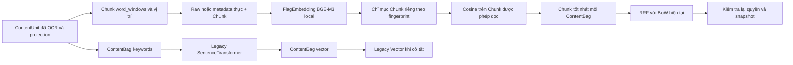

# BGE-M3 Chunk Semantic Search

## A. CURRENT STATE

Audit ngày 23/10/2026, nhánh `feat/search/bge-m3-contextual-retrieval`, HEAD ban đầu `971496c`.
Local đã provision BGE-M3, revision `5617a9f61b028005a4858fdac845db406aefb181`, 1024 chiều.
Code legacy dùng `LocalSentenceEmbedding`/SentenceTransformer nhưng đầu vào ContentBag là
`' | '.join(keywords)`, không phải nội dung Chunk. Vector lưu trong `content_bags`.



Audit không kết nối SOURCE Neon, DB Dev/Production hoặc đọc nội dung kho thật. Vì vậy số lượng vector
thực tế trong các DB đó chưa được xác nhận. Không chạy backfill hoặc đổi validator đang hoạt động.

## B. CHANGES MADE

| File | Nội dung |
| --- | --- |
| `src/data_sync_etl/ports/semantic.py` | Port embedding theo batch, store và lifecycle |
| `src/data_sync_etl/domain/semantic.py` | Chuẩn hóa vector, context template, mapping/hash |
| `src/data_sync_etl/adapters/bge_m3.py` | `BgeM3Embedding`: model local, batch, token budget, ColBERT |
| `src/data_sync_etl/adapters/mongo/semantic.py` | Installer additive, validator, lease, immutable records |
| `src/data_sync_etl/application/semantic.py` | `SemanticService`: plan/build/status/retrieve/rerank |
| `src/data_sync_etl/adapters/persistence/search_reader.py`, `ports/search.py` | Đọc tên môn/khối lớp còn hiệu lực, có giới hạn |
| `src/data_sync_etl/application/search.py` | Nối Vector mới vào quyền đọc, mapping Bag, RRF và final recheck |
| `src/data_sync_etl/application/evaluation.py` | Ghi model/strategy/index thật vào snapshot đánh giá |
| `src/data_sync_etl/config.py`, `composition.py` | Cờ opt-in và wiring riêng |
| `src/data_sync_etl/main.py`, `api/routes.py` | Preload/status/retry đúng model đang được chọn, tránh nạp hai model tại API |
| `src/data_sync_etl/api/search_schemas.py`, `frontend/src/types/search.ts` | Trường tùy chọn `vector_index`; giữ các trường/endpoint cũ |
| `src/data_sync_etl/cli/main.py` | Schema check/install, dry-run, batch backfill, resume và coverage status |
| `pyproject.toml`, `deploy/docker/constraints.semantic.txt`, `deploy/docker/backend.Dockerfile` | Bộ dependency semantic opt-in riêng |
| `deploy/compose.app.yml`, `deploy/runtime/runtime.py` | Cấu hình, mount model read-only và CLI Docker |
| `.env.example`, `deploy/docker.env.example` | Giá trị mẫu; không sửa env/secret đang chạy |
| `tests/semantic_support.py`, `tests/unit/test_semantic.py` | Kiểm thử độc lập và doubles chỉ dùng trong tests |
| `tests/integration/test_semantic_model.py` | Smoke model thật, bốn cấu hình trên cùng dữ liệu thử |
| `tests/integration/test_semantic_mongo.py` | Integration Mongo opt-in, chỉ DB test local đã tồn tại |

Không sửa thuật toán BoW, extractor, `content_bags.py`, adapter embedding legacy, SOURCE/Master schema,
Auth/RBAC, OCR/import/sync hay file học liệu gốc. Không tạo database hoặc xóa dữ liệu.

## C. VECTOR IMPLEMENTATION

### Model và đầu vào

`FlagEmbedding.BGEM3FlagModel`, dense 1024D, FP32, L2 normalization, CPU mặc định, batch 2.
Revision được kiểm tra bằng `etl-model-revision.txt`; model directory phải có config/tokenizer,
weights, `colbert_linear.pt` và `sparse_linear.pt`. Thiếu head không được ngầm khởi tạo random.
Đường dẫn tuyệt đối local được truyền vào loader; không truyền Hub ID trên đường inference.
API giữ một model đã chọn trong process; worker là process khác nên có bộ nhớ riêng.

Raw chỉ dùng văn bản Chunk. Contextual dùng template `verified-headings-v1`:

```text
Title: <tên học liệu thực>
Subject: <tên môn còn hiệu lực, nếu có>
Grade: <tên khối/lớp còn hiệu lực, nếu có>
Heading: <đề mục cha > đề mục hiện tại, nếu có>
Content: <nguyên văn Chunk>
```

Tên/nhãn lấy từ MASTER và cây ContentUnit. Không suy diễn metadata hoặc thêm từ đồng nghĩa.
Tiêu đề và mỗi dòng môn/khối giới hạn 240 ký tự; đường đề mục tối đa 720 ký tự.
ID, đường dẫn storage, hash và số trang không được thêm vào embedding text.
Văn bản gốc, thứ tự, offset, số trang và ordinal không đổi. BGE-M3 chỉ embedding văn bản đã trích xuất,
không trực tiếp embedding pixel hoặc âm thanh.

Giữ `word_windows` để tương thích context URL; tokenizer BGE kiểm tra đầu vào đầy đủ.
Nếu vượt `SEMANTIC_MAX_TOKENS`, báo `SEMANTIC_TOKEN_LIMIT`, manifest FAILED, không publish READY.
Không truncate nội dung âm thầm. Các record thành công ghi `token_count`, `truncated=false`.
Tăng token budget tối đa8192 hoặc chuẩn bị một chính sách chunking riêng có version trước khi reindex.
Word windows vẫn có thể ngắt giữa câu/bảng; đây là giới hạn chưa giải quyết trong task này.

### Storage, freshness và resume

Hai collection mới trong MongoDB hiện có:

- `semantic_chunk_indexes_v1`: manifest PENDING/RUNNING/READY/FAILED, expected count, identity,
  timestamp, owner/lease, error code.
- `semantic_chunk_vectors_v1`: Chunk/Unit/Bag/resource/version IDs, generation, page/offset/sequence,
  source fingerprint, raw/input hash, embedding text, model identity/revision/strategy/dimension,
  vector, token count và timestamp.

Index ID = digest của snapshot nội dung + metadata thực + model contract + strategy + context format.
Record ID = digest(index ID + Chunk ID). Unique `(index_id, chunk_id)`. Chỉ ghi `$setOnInsert`;
không ghi đè vector thuộc thế hệ cũ. READY chỉ sau khi kiểm tra đúng tập Chunk, mapping, hash,
vector hữu hạn/đúng chiều/chuẩn hóa và đọc lại snapshot mới nhất.

Thay văn bản, tiêu đề, môn/khối, đề mục hoặc revision/token contract tạo index ID khác.
Đổi storage path đơn thuần không tạo lại OCR hoặc thay source hash trong implementation này.
Chunk ID còn gắn với snapshot legacy, nên đổi model legacy cũng có thể yêu cầu xây lại semantic index.

CLI chạy lại sẽ bỏ qua record đã kiểm chứng, tiếp tục record thiếu. Worker chết để lại RUNNING;
chỉ reclaim khi lease hết hạn (`INDEX_TIMEOUT_SECONDS + 60`). Không cưỡng ép lấy lease đang hợp lệ.
Manifest/records được lưu bền trong Mongo nên việc restart container không mất tiến độ.
Không có cron hoặc backfill tự động lúc startup; học liệu mới/thay đổi cần chạy batch semantic tương ứng.

### Retrieval và ColBERT

Giữ bộ lọc metadata hiện có. Snapshot và policy cũ xác nhận quyền trước scoring; toàn bộ leaf trong
Bag và các ancestor phải được phép. Chỉ Chunk được phép mới góp điểm hoặc đi vào reranker.
Cosine thực hiện chính xác trên tập phiên bản đã lọc, với hard cap tổng số Chunk mỗi request,
không phải ANN hoặc quét corpus không giới hạn. Vượt cap trả lỗi để thu hẹp bộ lọc.
Lấy Chunk có cosine cao nhất mỗi Bag, tie-break theo ID; resource giữ kết quả Bag tốt nhất.
Không cộng thêm điểm vì một học liệu có nhiều Chunk giống nhau.

ColBERT tính trung bình trên token query của giá trị dot-product lớn nhất với các token document:
`mean_i max_j(q_i · d_j)`. Rerank tối đa20 ứng viên mặc định (cấu hình1–50), theo batch; không lưu
token vectors vào Mongo. Chỉ rerank các Chunk đã qua kiểm tra quyền. Sau rerank dùng thứ tự ColBERT
trong tập ứng viên này; không trộn trực tiếp điểm ColBERT với cosine ngoài tập.
Đây là late interaction, không phải cross-encoder. Reranker tắt mặc định vì chi phí CPU.

Giới hạn thời gian native inference là cooperative: kiểm tra trước/sau batch, không force-kill torch.
HTTP giữ cơ chế admission/FIFO/deadline hiện có để hạn chế số request bỏ dở.
Timeout có thể xảy ra khi cold-load hoặc rerank nhiều ứng viên; preload/API status và Docker memory/CPU
limits vẫn cần thiết. Điểm cosine/ColBERT không phải xác suất liên quan.

### Cấu hình local

Trong venv riêng cho nhánh semantic:

```bash
python -m pip install "torch==2.14.1+cpu" --index-url https://download.pytorch.org/whl/cpu
python -m pip install -e ".[semantic,dev]"
```

FlagEmbedding1.3.5 không tương thích Transformers5 (đã tái hiện lỗi import). Extra semantic chốt
Transformers4.51.3, SentenceTransformers3.4.1, PEFT0.15.2, Hub0.30.2, Datasets3.6.0, Accelerate1.6.0.
Không thay dependency của image legacy khi `INSTALL_SEMANTIC=false`.

Thêm/sửa trong `.env` local, giữ nguyên DB/auth/legacy `INDEX_EMBEDDING_*` hiện có:

```dotenv
SEMANTIC_ENABLED=false
SEMANTIC_MODEL_PATH=./Models/bge-m3
SEMANTIC_MODEL_REVISION=5617a9f61b028005a4858fdac845db406aefb181
SEMANTIC_STRATEGY=contextual
SEMANTIC_DEVICE=cpu
SEMANTIC_BATCH_SIZE=2
SEMANTIC_MAX_TOKENS=1024
SEMANTIC_MAX_CANDIDATES=10000
SEMANTIC_MIN_SCORE=0
SEMANTIC_RERANK_ENABLED=false
SEMANTIC_RERANK_TOP_K=20
```

Chỉ chạy các lệnh ghi sau trên môi trường đích được phép, sau khi kiểm tra đúng URI/database:

```bash
# Check không sửa schema. --apply chỉ tạo hai collection/index mới, không collMod legacy.
python -m data_sync_etl.cli.main semantic-schema
python -m data_sync_etl.cli.main semantic-schema --apply

# Dry-run mặc định; thay VERSION_ID bằng ResourceVersion ID thật đã CONTENT_READY.
python -m data_sync_etl.cli.main semantic-index --resource-version-id VERSION_ID
python -m data_sync_etl.cli.main semantic-index --resource-version-id VERSION_ID --apply
python -m data_sync_etl.cli.main semantic-status --resource-version-id VERSION_ID

# Một batch latest eligible versions, mặc định dry-run; tối đa100 học liệu/batch.
python -m data_sync_etl.cli.main semantic-index --full --limit 20
python -m data_sync_etl.cli.main semantic-index --full --limit 20 --apply
# Nếu output có next_after_resource_id, tiếp tục với chính cursor đó:
python -m data_sync_etl.cli.main semantic-index --full --limit 20 --after-resource-id RESOURCE_CURSOR --apply
```

Cũng có thể lặp `--resource-version-id` để chọn một batch cụ thể. Lỗi một phiên bản được ghi riêng;
CLI trả PARTIAL và exit1 khi có lỗi. Không dùng cursor để bỏ qua các phiên bản lỗi: chạy lại từng ID đó.
`semantic-status` không nạp model hoặc ghi DB; xác nhận `coverage_verified=true` và expected=persisted.
Chỉ khi toàn bộ corpus cần truy vấn đã READY mới bật `SEMANTIC_ENABLED=true`, restart API.
`SEMANTIC_STRATEGY=raw` chọn baseline; đổi strategy phải xây index tương ứng trước khi bật.

Không đổi `INDEX_EMBEDDING_DIMENSION=384` thành1024 chỉ để bật feature này nếu ContentBag còn384D.
Dùng `SEMANTIC_MODEL_PATH` riêng và giữ validator/vector legacy nguyên trạng.

### Docker

Trong `docker.env`, giữ DB connections/secrets/auth hiện tại; thêm:

```dotenv
INSTALL_SEMANTIC=true
SEMANTIC_ENABLED=false
SEMANTIC_MODEL_REVISION=5617a9f61b028005a4858fdac845db406aefb181
SEMANTIC_MODEL_DIR=D:/etl/models/bge-m3
SEMANTIC_STRATEGY=contextual
SEMANTIC_RERANK_ENABLED=false
```

`SEMANTIC_MODEL_DIR` là thư mục BGE local đã provision; nếu bỏ qua sẽ dùng `MODEL_DIR`.
Compose mount model mới read-only tại `/opt/models/semantic`; mount legacy vẫn riêng.
Image này CPU-only; `cuda:0` có thể cấu hình ở local có torch/CUDA phù hợp, GPU Docker chưa nghiệm thu.

Git Bash/PowerShell, từ root repo:

```bash
powershell.exe -NoProfile -ExecutionPolicy Bypass -File deploy/scripts/etl-docker.ps1 -Action Build -EnvFile docker.env
```

CLI Docker sử dụng entrypoint hiện có để nạp connections secret, không truyền credential trên command line.
Ví dụ dưới dùng auth profile và SOURCE Neon; nếu DB cùng máy bỏ `-f deploy/compose.source-neon.yml`.
Nếu đang dùng Auth DB/TLS/Drive, dùng đúng các overlay tương ứng của deployment hiện tại.

```bash
docker compose --env-file docker.env -f deploy/compose.app.yml -f deploy/compose.auth.yml -f deploy/compose.source-neon.yml run --rm --no-deps api semantic-schema
docker compose --env-file docker.env -f deploy/compose.app.yml -f deploy/compose.auth.yml -f deploy/compose.source-neon.yml run --rm --no-deps api semantic-schema --apply
docker compose --env-file docker.env -f deploy/compose.app.yml -f deploy/compose.auth.yml -f deploy/compose.source-neon.yml run --rm --no-deps api semantic-index --full --limit 20 --apply
docker compose --env-file docker.env -f deploy/compose.app.yml -f deploy/compose.auth.yml -f deploy/compose.source-neon.yml run --rm --no-deps api semantic-status --resource-version-id VERSION_ID
```

Sau coverage READY, đặt `SEMANTIC_ENABLED=true` rồi chạy launcher Start như README gốc.
Rollback: `SEMANTIC_ENABLED=false`, restart API; không xóa hai collection mới. Nếu cần bộ thư viện
legacy nguyên gốc, dùng lại tag image legacy đã lưu. Không thay đổi cấu hình cờ Auth để nghiệm thu Search.

## D. SEARCH COMPATIBILITY

| Thành phần | Hành vi |
| --- | --- |
| `bow` | Thuật toán, keywords và mapping Bag không đổi; không gọi BGE mới |
| Legacy vector | Cờ mặc định false; adapter/model/ContentBag cũ được giữ |
| New vector | Dense từ nội dung Chunk; không dùng vector chuỗi keywords làm kết quả semantic |
| Hybrid | RRF cũ trên ID Bag sau mapping Chunk→Unit→Bag; không cộng trực tiếp cosine/BoW |
| Quyền đọc | Policy, điều kiện publication/eligibility/ancestor và final snapshot recheck cũ vẫn áp dụng |
| API | Giữ endpoint, locator, paging và trường cũ; `vector_index` chỉ xuất hiện khi dùng semantic |
| Runtime | Model status/retry/capabilities phản ánh adapter đang được chọn |

`vector_index` ghi model/revision/dimension/strategy và index IDs của kết quả được phép trả về.
`ranking_algorithm` phân biệt legacy, raw/contextual, ColBERT và RRF.
Vector/Hybrid fail-closed khi model/index không READY, theo policy hiện tại; không tự báo BGE nhưng dùng
vector cũ. `bow` vẫn gọi độc lập được trong tình huống đó. Chưa thêm fallback Hybrid tự động sang BoW.
Các nút/status index trong trang chi tiết hiện vẫn mô tả chỉ mục ContentBag legacy; coverage semantic
kiểm tra bằng CLI. Không đổi BoW hoặc lấn sang UI quản trị chỉ mục trong task này.

## E. VERIFICATION

Kết quả và lệnh kiểm tra cuối cùng nằm trong [VERIFICATION.md](VERIFICATION.md).
Unit tests dùng doubles chỉ kiểm tra orchestration/permission/fingerprint/rollback, không chứng minh
chất lượng BGE. Smoke riêng dùng model thật và không kết nối DB. Docker smoke tắt mạng hoàn toàn.

Integration Mongo chỉ chạy khi operator cung cấp **database test local đã tồn tại** có prefix `etl_test_`:

```dotenv
SEMANTIC_TEST_MONGO_URI=mongodb://127.0.0.1:27018
SEMANTIC_TEST_MONGO_DATABASE=etl_test_semantic
SEMANTIC_TEST_ALLOW_INSTALL=1
```

Không tự tạo database trong test. Installer chỉ được gọi khi opt-in; test generations được giữ lại,
không drop collection/DB. Nếu không có fixture này, báo SKIP, không coi memory store là MongoDB thật.

## F. RESEARCH RESULTS

Smoke trên4 văn bản tự tạo,6 truy vấn Việt/Anh/trộn ngôn ngữ, cùng corpus và qrels cho bốn phương pháp.
Legacy ở đây là BGE-M3 qua adapter SentenceTransformer hiện tại với keywords, không phải MiniLM.
Số liệu chi tiết nằm trong VERIFICATION và JSON evidence. Các phương pháp cùng top1=6/6;
chưa có bằng chứng Contextual tăng chất lượng so với Raw/legacy trên bộ này.

Để đánh giá khóa luận, dùng evaluation framework hiện có với corpus thật và nhãn đã xác nhận.
Framework đã ghi thêm semantic identity/index/strategy/rerank vào corpus fingerprint, không gán nhầm
run BGE cho model legacy. Không thay ground truth giữa các cấu hình; lưu cùng resource/version IDs,
queries/qrels, split validation/test, quyền đọc và checksum corpus. Đổi strategy phải tạo snapshot/run
tương ứng; dataset cũ sẽ bị từ chối nếu fingerprint không khớp.

Chấm nhãn thêm truy vấn không liên quan, phủ định, mơ hồ, Unicode NFD/không dấu, mô tả dài,
Việt–Anh và tài liệu tiêu đề giống nhưng nội dung khác. Tập validation dùng chọn token budget,
candidate cap, ngưỡng `SEMANTIC_MIN_SCORE` và rerank Top-K; chỉ báo kết quả trên test độc lập.
Ngưỡng0 mặc định không phải giải pháp đã hiệu chỉnh cho no-result trên corpus thật.
Precision@5 dùng mẫu số5 kể cả corpus nhỏ hơn5; recall/MRR/nDCG không đủ phân biệt trên smoke nhỏ.

Dual embeddings chưa triển khai: có thể chạy Raw và Contextual thành hai thế hệ riêng để so sánh,
nhưng không có weighted alpha hoặc kết luận tốt hơn khi chưa có validation/test có gán nhãn.
BoW cải tiến trong tương lai chỉ cần cung cấp ranking Bag vào RRF hiện có, không thay BGE store.

## G. REMAINING RISKS

- Chưa chạy migration/backfill trên kho thật hoặc integration Mongo vật lý do chưa có fixture DB test
  được chỉ định. Không tự cấp quyền hoặc sửa Dev/Production để làm test PASS.
- Chưa có corpus thật/qrels đã xác nhận; chưa kết luận hiệu quả nghiên cứu, no-result hoặc ngôn ngữ khác.
- Exact cosine có hard cap; cần benchmark corpus lớn trước production. Không tuyên bố ANN.
- Chưa nghiệm thu crash/restart Docker với Mongo thật, GPU, mọi loại tệp và endpoint end-to-end trên
  dữ liệu đồng bộ thật. Resume/permission được kiểm tra trên fixture và state machine.
- Context metadata có thể sai do nguồn; implementation chỉ dùng giá trị thực, không tự sửa dữ liệu.
- CPU rerank tăng latency, native torch không bị hủy ngay theo HTTP deadline; giữ cờ rerank tắt mặc định.
- Cần job vận hành chạy semantic batch cho tài liệu mới/thay đổi; `INDEX_AUTO_ENABLED` hiện tại chỉ
  điều khiển legacy index, không tự backfill semantic. Coverage CLI là gate bật feature.

## H. FINAL STATUS

**PARTIAL** cho nghiệm thu tổng thể: implementation và kiểm thử độc lập đã có; nghiệm thu corpus thật,
Mongo vật lý và vận hành restart chưa đủ điều kiện. Feature/reranker mặc định tắt, legacy được giữ.
Không commit/push/merge/deploy hoặc thay đổi dữ liệu đang hoạt động trong task này.

Nguồn chính thức: [BGE-M3 model card](https://huggingface.co/BAAI/bge-m3),
[FlagEmbedding](https://github.com/FlagOpen/FlagEmbedding),
[BGE-M3 và ColBERT scoring](https://bge-model.com/bge/bge_m3.html).
